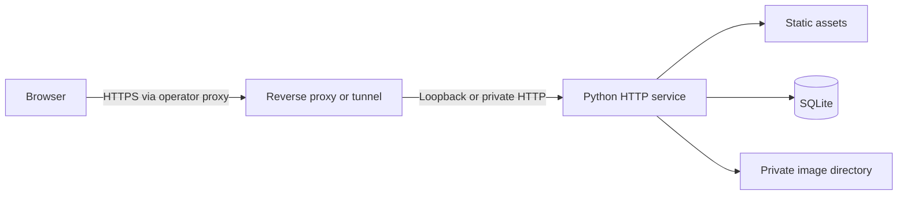

# Technical reference

This document is the canonical technical reference for AI Content Studio. It follows the owner's Project Technical Documentation Standard v1.2 at a scale appropriate to this application. Repository code and configuration are authoritative when this document and implementation differ.

## 1. Overview and scope

AI Content Studio is a self-hosted planning dashboard for projects, episodes, characters, production workflow notes, reference images, and a shared tools catalog. It provides local account management and private per-user workspaces. It does not generate media, publish content, send email, or provide external identity services.

## 2. Goals and non-goals

The application favors a small deployable surface, private workspace isolation, explicit destructive actions, and a reversible migration path from the single-owner edition. High availability, distributed storage, horizontal scaling, billing, service-level objectives, and managed account recovery are not implemented or specified.

## 3. Sources of truth

`server.py` is the source of truth for API behavior, schema migration, security controls, configuration parsing, and the application version. `dist/index.html`, `dist/style.css`, `dist/app.js`, and `dist/seed.js` define the browser application. `compose.yaml`, `Dockerfile`, and `.env.example` define the packaged runtime. SQLite and the configured image directory are the runtime data sources of truth.

## 4. Data lifecycle

An administrator is bootstrapped only when no administrator exists. Each user owns one revisioned workspace JSON document. Project, episode, and character archive states live in that document; permanent workspace deletions are saved through the same revision-aware update. Character image metadata lives in SQLite and bytes live under the image root. User deletion cascades through database-owned records and removes that user's uploaded files. JSON export moves text only. Complete backup and restore must include the database and image directory together.

## 5. System architecture

The provided container runs one threaded Python process. Static files and JSON routes share the same origin. The reverse proxy is operator-managed and is not included in this repository.

## 6. Trust boundaries

The public browser boundary ends at the HTTPS proxy. The application trusts forwarded client identity only when the immediate peer belongs to `AICS_TRUSTED_PROXY_NETWORKS`; otherwise it uses the peer address. Browser state changes require same-origin checks, an authenticated server-side session, and a CSRF token. Administrator routes enforce the role on the server. The database and image directory are private persistent data and must not be served directly.

## 7. Request and data flows

Unauthenticated clients may load static assets, query session state, sign in, and register only when registration is enabled. Successful login creates a random token, stores only its hash in SQLite, and returns the raw token in a cookie. Authenticated reads load the account, workspace, tools, or owner-scoped image. Writes validate input and use the CSRF header. Workspace saves compare revisions and return a conflict instead of silently overwriting concurrent changes.

## 8. Technology stack

- Python standard library HTTP server and `sqlite3`
- SQLite in WAL mode with foreign keys and a busy timeout
- Dependency-free HTML, CSS, and JavaScript frontend
- Python 3.13 Alpine container image
- Docker Compose with a named persistent volume

There is no package manager lockfile because the application has no third-party runtime library dependency. The base image remains an external supply-chain dependency that must be reviewed during release preparation.

## 9. Data model

Schema version 3 uses `users`, `workspaces`, `sessions`, `app_settings`, `login_attempts`, `tools`, and `character_images`. Users have a role, active state, optional archive time, display name, password record, and theme. Workspaces are keyed by user ID and contain a revision plus JSON. Sessions contain token hashes, CSRF tokens, and fixed expiry times. Tools are shared catalog records. Image metadata is unique per user and character.

Workspace JSON retains existing project IDs and accepts legacy structures through migration and normalization. The legacy `workspace` table is left intact after its first non-destructive copy to the initial administrator.

## 10. Identity and access

Roles are `admin` and `user`. Self-registration can create only `user` accounts. Administrators manage registration, roles, user lifecycle, and tools. Users can change their own display name, password, and theme. Disabled or archived users cannot sign in, and their sessions are revoked. A signed-in administrator cannot delete themselves, and the final active administrator cannot be removed from that role or access state.

## 11. Authentication and sessions

Passwords are limited to 12 through 256 characters and stored using salted PBKDF2-SHA256 with 600,000 iterations. Login requests are size-limited and throttled atomically by source before password verification. Sessions are random, stored server-side by token hash, and expire at a fixed time. Cookies are HttpOnly, SameSite Strict, and Secure unless explicitly disabled for local HTTP development. Password changes revoke all sessions for that user.

## 12. Configuration

Documented variables are `AICS_ADMIN_USERNAME`, `AICS_ADMIN_DISPLAY_NAME`, `AICS_ADMIN_PASSWORD`, `AICS_REGISTRATION_ENABLED`, `AICS_MAX_USERS`, `AICS_REGISTRATION_ATTEMPT_LIMIT`, `AICS_COOKIE_SECURE`, `AICS_SESSION_HOURS`, `AICS_TRUSTED_PROXY_NETWORKS`, and `AICS_IMAGE_ROOT`. The container also sets `AICS_DB_PATH=/data/studio.sqlite3` and `PORT=8787`. Legacy `AICS_USERNAME` and `AICS_PASSWORD` remain bootstrap fallbacks for upgrade compatibility.

Secrets belong in an untracked `.env` or an operator-managed secret mechanism. Bootstrap credentials should be removed after the initial administrator exists.

## 13. Hosting and environments

Development may run natively with a temporary SQLite path and insecure local cookie setting. The packaged self-hosted environment uses Docker Compose, a loopback port binding, and `studio_data`. A public installation requires an operator-managed HTTPS endpoint. Hostnames, proxy products, network ranges, storage locations, and production topology are intentionally installation-specific and are not defined here.

## 14. Delivery behavior

The service returns static assets and API responses with `Cache-Control: no-store`, content-type sniffing protection, same-origin referrer and opener policy, a restrictive permissions policy, and a self-only content security policy. HSTS is returned when Secure cookies are enabled. `/healthz` is the container health endpoint. The application version comes from `APP_VERSION` and is delivered through `/api/session` for both authenticated and signed-out footers.

## 15. Stable links and assets

Browser routes use one document and client-side section selection; deep-linkable section URLs are not implemented. API paths under `/api/` and `/healthz` are operational interfaces, but no external compatibility guarantee or formal API version exists. `/favicon.svg` is the original project mark used by login and application chrome. External tool URLs are administrator-managed HTTPS links and are not endorsements or availability guarantees.

## 16. Operations, backup, and restore

Monitor container health, restart behavior, persistent storage capacity, authentication failures, and application logs without recording request bodies or credentials. The server logs method, path, and status only. A consistent SQLite backup plus a copy of the image directory is required for complete recovery. Restore both from the same backup point and verify login, workspace revisions, images, tools, and lifecycle flags. No retention period, recovery objective, or service objective is defined by the repository.

## 17. Deployment and change management

Build and test the exact reviewed commit. Before upgrades, stop edits and create an off-host backup. Preserve the volume and never use `docker compose down -v` during a normal update. First startup applies idempotent schema creation and migration. Validate health, HTTPS, Host and Origin behavior, cookies, authentication, migrated content, and backups before declaring rollout complete. Use the [deployment guide](DEPLOYMENT.md) for preparation and rollback checks.

## 18. Validation evidence

The repository contains Python integration tests in `tests/test_server.py`, JavaScript syntax checks, Python compilation checks, and HTML validation-compatible markup. Test results belong in each pull request and must state the exact commit and environment. Browser appearance, live proxy behavior, backup restoration, and production rollout are unverified unless the relevant pull request records direct evidence. Historical claims are not promoted to current evidence here.

## 19. Security, privacy, limitations, and troubleshooting

Private data includes credentials, session material, workspace content, images, databases, exports, backups, and logs. Keep it out of Git and protect it at rest and in transit. The application has no MFA, email verification, password-reset email, external identity provider, audit log, malware scanner, or image transcoder. It validates supported image signatures and size but is not a general hostile-file analysis service.

For startup failures, verify required bootstrap values only when no admin exists, writable database and image paths, and valid trusted-proxy CIDRs. For login loops, verify the public Host is preserved, HTTPS is active, and Secure cookies are not being tested over plain HTTP. For 403 writes, inspect Origin, Host, session expiry, and CSRF state. For revision conflicts, reload before retrying. For missing images after restore, confirm the database and image directory came from the same backup.

Security reporting guidance is in [SECURITY.md](SECURITY.md). Installation-specific investigation may require authorized production access.

## 20. Roadmap and appendices

Deferred possibilities include stronger account recovery and identity controls, formal API versioning, automated browser coverage, and documented recovery objectives. None is committed to a date. The owner selected the MIT License for version 0.1.0.

Related references:

- [README](../README.md)
- [Deployment guide](DEPLOYMENT.md)
- [Contributing guide](CONTRIBUTING.md)
- [Security policy](SECURITY.md)
- [Changelog](../CHANGELOG.md)

Glossary: a workspace is one user's revisioned JSON planning document; the image root is private file storage for character references; a trusted proxy is an explicitly configured immediate network peer permitted to supply `CF-Connecting-IP`.
